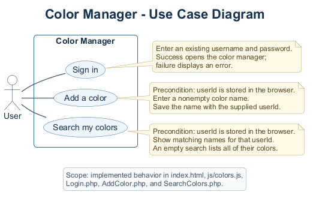
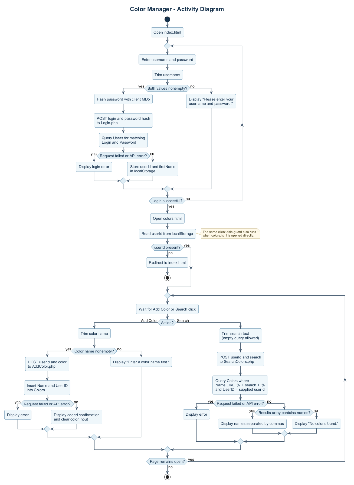
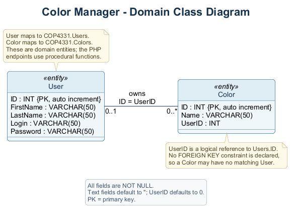

# Color Manager UML diagrams

These diagrams describe the current implementation of Color Manager.

| Diagram | PlantUML source | Rendered image |
| --- | --- | --- |
| Use case | [usecase.puml](usecase.puml) | [usecase.png](usecase.png) |
| Activity | [activity.puml](activity.puml) | [activity.png](activity.png) |
| Domain class | [class.puml](class.puml) | [class.png](class.png) |

The use case diagram shows the user's three available actions. The activity
diagram follows login, color creation, and user-scoped search, including input
validation and error paths. The class diagram models the `Users` and `Colors`
tables in [`schema.sql`](../../LAMPAPI/sql/schema.sql).

The class diagram represents domain entities; the PHP API uses procedural
functions rather than PHP classes. `Colors.UserID` is a logical reference to
`Users.ID`, with no database foreign key constraint. The color page checks for
`userId` in browser local storage; the API receives that ID in each request.

## Render the diagrams again

Install Java and download [PlantUML 1.2026.8](https://github.com/plantuml/plantuml/releases/tag/v1.2026.8).
Run this command from the repository root, replacing `path/to/plantuml.jar`
with the downloaded JAR's location:

```text
java "-Djava.awt.headless=true" -jar path/to/plantuml.jar -charset UTF-8 -failfast2 -tpng docs/uml/usecase.puml docs/uml/activity.puml docs/uml/class.puml
```

Keep [`style.puml`](style.puml) beside the three sources. The use case and class
diagrams use PlantUML's bundled Smetana layout engine, so Graphviz is not required.
Commit the updated `.puml` and `.png` files together after any changes.

## Use case diagram



## Activity diagram



## Domain class diagram


